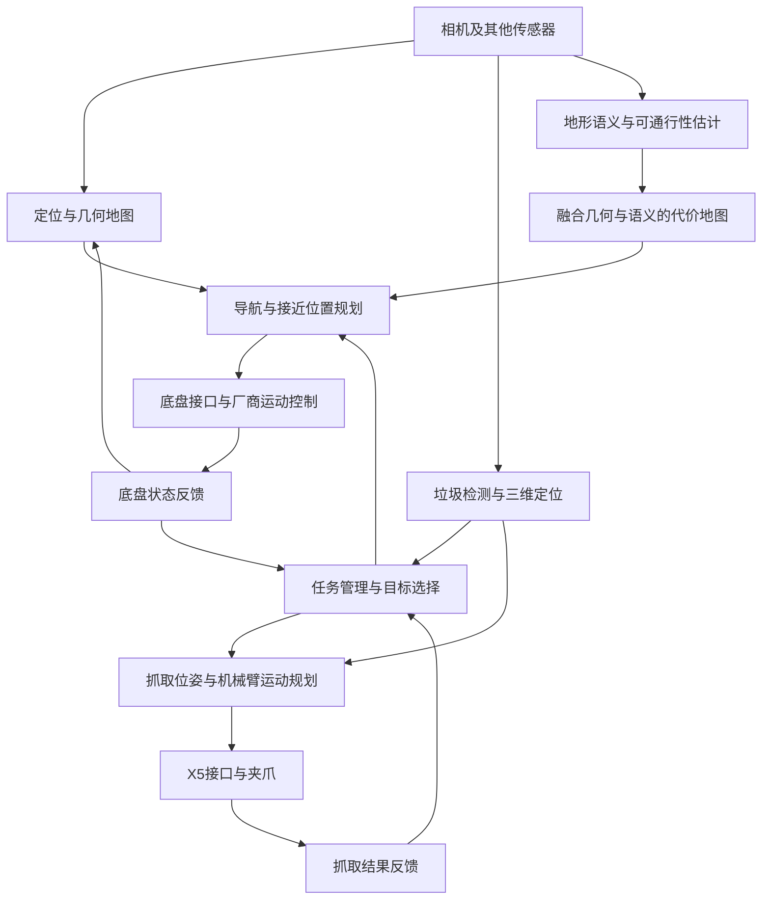

# 项目上下文：Go2-W + X5 野外垃圾捡拾

更新日期：2026-11-11。本文面向刚入组的本科生，也供其他聊天读取。它描述项目目标和建议的系统组织方式；除明确注明的官方资料核验外，不表示整套系统已经实现。

## 1. 已知事实与本仓库的任务

- 团队由一位研究生带四位本科生开展项目。
- 据交付群资料，平台为宇树 **Go2-W + X5 机械臂**，设备已由供应方现场交付调试。这是用户提供的信息，本仓库尚未复核整机配置或运行状态。
- 目标是清理高速公路路侧等人工清理困难区域的垃圾。具体作业边界、垃圾种类、收集容器和成功标准尚未确定。
- 当前个人任务：调研三个技术方向并选择兴趣方向；准备本机环境；初步了解野外语义可通行性与现有 demo。
- 本仓库主要承担工程部署、接口整理与验证记录。当前先完成基本建仓，不开展完整文献调研或安装整套软件。

工作边界：需要真机的内容留到统一上机；涉及服务器部署或连接时先向使用者说明。学习和离线验证尽量在本机完成。

## 2. 这不是一个单独的识别或抓取算法

可以把系统理解为“会移动的抓取工作站”：机器狗把机械臂送到合适位置，相机和其他传感器提供环境信息，机械臂完成近距离操作，任务管理模块把这些步骤串起来。

下面是**建议架构**。ROS 2、Nav2 等仅作为候选软件框架，是否采用及版本需要核对交付系统。



图里有三条容易混淆的链路：

1. **在哪里、怎么过去**：定位、地图、可通行性判断、路径规划、底盘执行。
2. **垃圾是什么、在哪里、怎么抓**：识别、三维定位、坐标转换、抓取位姿和机械臂轨迹。
3. **什么时候做哪一步**：目标选择、导航完成判定、停稳、抓取、投放、失败处理。

第三条需要一个任务管理模块。没有它，即使各个 demo 都能单独运行，整机也不会自动完成捡拾。

## 3. 一次捡拾怎样完成

以下是便于入门的流程建议，尚未实现：

1. 在限定作业区域内获得机器人位置和环境观测。
2. 发现疑似垃圾，给出类别、置信度及可用的三维位置。
3. 选择一个可处理目标，规划**机械臂能够操作的底盘停靠位置**，而非直接驶向垃圾中心。
4. 结合几何障碍、地形风险、机器人尺寸和姿态规划接近路线。
5. 到达后停稳，再观测目标，更新近距离位置；远处检测结果可能已因遮挡或定位误差而不准确。
6. 将目标从相机坐标转换到机械臂基座坐标，生成合适的抓取姿态。
7. 检查机械臂可达性、碰撞和关节限制，规划并执行抓取。
8. 判断是否抓住，移动到待确定的收集位置、投放并确认，再处理下一个目标。

初期可以先做“固定底盘、单个已知物体”的离线或受控验证，逐步增加移动与自动决策。移动底盘和机械臂同时协同运动会显著增加复杂度，当前不预设必须采用。

## 4. 三个调研方向分别是什么

| 方向 | 真正要解决的问题 | 主要交付给下游的信息 | 本机可先做的工作 |
| --- | --- | --- | --- |
| 导航与运动控制 | 从当前位置到停靠位置，途中如何绕障、选择地形、执行运动 | 路径、底盘运动请求、到达或失败状态 | 读 SDK，了解导航数据流，使用模拟地图或回放数据 |
| 视觉感知 | 垃圾在哪里，哪些地形可能可走，结果有多可靠 | 检测框或掩膜、三维位置或位姿、地形语义与置信度 | 图片检测与分割 demo，理解深度、标定和坐标转换 |
| 机械臂抓取 | 从观测目标得到可执行且可验证的抓取动作 | 抓取姿态、关节轨迹、夹爪命令与执行结果 | 查看 X5 SDK、模型与 IK 示例，做不连接设备的数学验证 |

导航与底层运动控制是不同层次：前者决定路线和接近方式，后者负责实现运动。工程起步阶段应先核对厂商已有控制能力和接口，再判断哪些部分需要自行开发，不能默认需要重写步态控制。

视觉的二维检测框只说明图像里哪里像垃圾，并不会自动给出机械臂所需的米制三维坐标。常见路线要利用深度或点云、相机内外参及坐标变换；项目相机类型与可用数据尚未确认。三维位置也不等于完整抓取位姿：抓取还需要朝向、夹爪开度及接近方式。并非所有垃圾都必须估计完整物体六维位姿，所需输出应由具体抓取策略决定。

逆运动学（IK）回答“给定末端位姿（位置和朝向），有哪些关节角可以达到”。它是抓取链路的一部分；有 IK 解仍需检查碰撞、关节限制、轨迹和执行反馈。X5 官方仓库已经提供 IK 相关示例，先核对适用型号和输入输出，详见 [官方资料](docs/RESOURCES.md)。

## 5. 学长提出的语义代价问题

更准确地说，这个问题位于**环境理解、可通行性估计和导航代价地图**之间。SLAM 主要解决定位与地图构建；“这里机器人能否通过”还要结合导航系统和机器人自身条件，不能把所有误判都归因于 SLAM。

几何信息告诉我们地形的形状、高度和障碍位置；语义信息帮助判断它可能是什么，如草、泥地、碎石、硬路面。**代价**是规划器用于比较路线的数值：代价较高表示更应避开，某些区域可以被设为不可进入。Nav2 的代价地图是可组合图层的栅格表示；把语义结果接入代价图层是一种可研究的工程方案，当前尚未选型或实现。

一条候选数据链是：

```text
图像语义分割 + 深度/点云 + 对齐的时间戳和坐标变换
    → 将语义落到地面空间位置
    → 融合坡度、粗糙度、障碍和不确定性
    → 为当前机器人与运动模式赋代价
    → 供路径规划和局部避障使用
```

“草”不应被统一改成可通行，“泥地/碎石”也不一定全部不可通行。草可能遮住沟或硬物；泥地的软硬、碎石的大小和坡度都会影响通过性，轮行与足行的能力也可能不同。单张 RGB 图像通常不能直接证实地面承载力、摩擦或草下结构。因此目标是让判断更有依据，并对不确定区域保留风险信息。

后续看 demo 时，重点检查三件事：输出只是漂亮的分割图，还是能落到空间地图；代价是否影响规划结果；是否在相同路线与条件下，和只用几何信息的基线进行了比较。当前没有筛选或运行这类 demo，也没有确定研究方案。

## 6. “主要对接接口”具体对接什么

下面是**逻辑接口草案**，不是官方话题名或已经确定的消息协议。真实名称、频率和单位必须读取 SDK 与交付配置后填写。

| 接口两端 | 要交换什么 | 首先对齐什么 |
| --- | --- | --- |
| 传感器 → 感知/定位 | 图像、深度、点云、惯性或里程计数据（依实际设备） | 数据来源、时间戳、标定、坐标系 |
| 识别 → 目标管理/抓取 | 目标编号、类别、位置或位姿、置信度 | 米制坐标、参考坐标系、观测时刻、输出是否过期 |
| 地形理解 → 导航 | 空间代价、未知区域和几何障碍 | 地图坐标系、分辨率、代价含义、图层融合规则 |
| 导航 → 底盘适配层 | 速度或运动目标请求、停止请求 | SDK能力、单位、模式、超时与执行状态 |
| 抓取规划 → X5适配层 | 关节或末端目标、夹爪请求 | 关节顺序、弧度/角度、可达范围、命令方式 |
| 底盘/机械臂 → 任务管理 | 到达、停稳、执行成功或失败 | 状态定义、失败后下一步、是否可取消 |

ROS 2 的 topic 可用于持续数据，service 可用于短请求，action 可用于需要反馈或取消的长任务；具体是否使用这些机制取决于最终软件栈。厂商 SDK 接口与 ROS 接口也可能通过适配层连接。

### 坐标与时间是公共基础

一个候选坐标关系如下，名字只是惯例示意：

```text
map → odom → base_link
                ├─ camera_link → camera_optical_frame
                └─ arm_base → 各关节坐标系 → tool0
```

- `map/odom` 表达环境中的定位关系；`base_link` 表达底盘；`arm_base` 表达机械臂安装基座。
- 相机装在机身还是腕部尚未知。上图仅示意机身固定相机；腕部相机的关系需接到对应关节或末端。
- 相机相对安装位置需通过合适的标定获得；机械臂到机身的安装变换也要核实。
- 例如，把相机中的目标点用于抓取，需要计算 `p_arm = T_arm_camera · p_camera`。这里使用齐次坐标，`T_arm_camera` 表示从相机坐标转换到机械臂基座坐标的变换。
- 机器人运动时，必须用与观测时刻相匹配的变换，并统一时间基准。ROS 的 tf2 可以组织随时间变化的坐标变换，但它不会替代真实标定。

## 7. 目前还不能假定的配置

相机型号与安装位置、深度能力、雷达配置、算力板系统与架构、交付 ROS 版本、X5 年款与控制器、夹爪、URDF 与外参、已有导航/抓取软件、载荷与供电约束、收集容器都待核实。待办统一放在 [STATUS.md](STATUS.md)，环境路线见 [docs/SETUP.md](docs/SETUP.md)。

本文仅建立学习和工程上下文，不代表真实道路作业能力或整机验证结果。

## 概念参考

以下官方资料用于解释概念，不代表已决定采用对应软件或版本；访问日期为 2026-11-11。

- [Nav2：Costmap 2D](https://docs.nav2.org/jazzy/configuration_and_development/configuration_guide/core_servers/costmap_2d/)：代价地图与可组合图层。
- [ROS 2：tf2 官方文档源码](https://github.com/ros2/ros2_documentation/blob/rolling/source/ROS-Framework/interfaces/About-Tf2/About-Tf2.rst)：坐标关系与随时间变化的变换。
- [ROS 2：接口概念官方文档源码](https://github.com/ros2/ros2_documentation/blob/humble/source/Concepts/Basic/About-Interfaces.rst)：消息、服务与动作接口。
